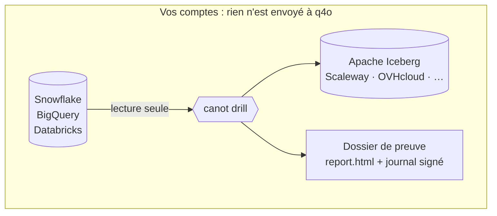
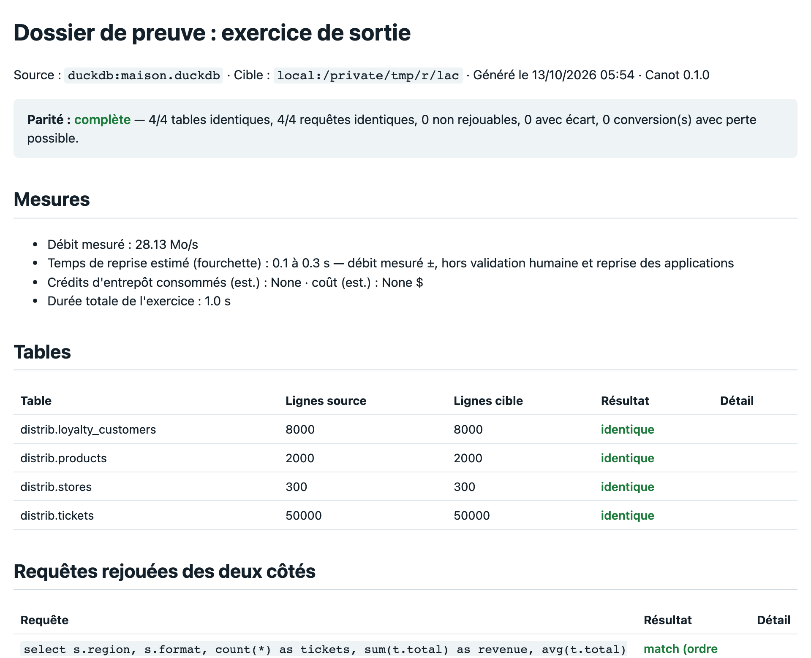

<p align="center">
  <picture>
    <source media="(prefers-color-scheme: dark)" srcset="docs/assets/banner-dark.svg">
    
  </picture>
</p>

<p align="center">
  <b>Prouvez que vous pouvez partir.</b> · <i>Prove you can leave.</i><br>
  Copie, compare et signe : un exercice de sortie de votre plateforme de données, dans vos comptes.<br>
  <a href="https://canot.io">canot.io</a> : le site, un exemple de rapport et la prise de contact.
</p>

<p align="center">
  
  
  
  
  
</p>

<p align="center">
  <a href="https://canot.io"><b>canot.io</b></a> ·
  <a href="#-démonstration">Démonstration</a> ·
  <a href="#-pourquoi">Pourquoi</a> ·
  <a href="#%EF%B8%8F-comment-ça-marche">Comment ça marche</a> ·
  <a href="#-démarrer">Démarrer</a> ·
  <a href="#-où-en-est-le-projet">État</a> ·
  <a href="docs/livrables.md">Livrables</a> ·
  <a href="docs/cibles-ue.md">Hébergeurs</a>
</p>

---

## ▶ Démonstration

<p align="center">
  
</p>

Sur un jeu public BigQuery : **3,3 millions de lignes** copiées en moins d'une minute, 7 tables identiques ligne par ligne, 3 requêtes sur 4 qui rendent le même résultat. La 4<sup>e</sup> rend une date chez BigQuery et une date avec heure ailleurs. C'est le genre d'écart qu'on veut découvrir **avant** de partir.

## 🧭 Pourquoi

|  |  |  |
|---|---|---|
| **Le déséquilibre** | **La pression** | **Le risque caché** |
| Snowflake et Databricks offrent des outils gratuits pour *entrer*. Personne n'offre l'outil qui vérifie la *sortie*. | DORA demande un plan de sortie **testé** aux entités financières. Le Data Act supprime les frais de changement de cloud le **12 janvier 2027**. | Un plan de sortie sur papier n'a jamais été exécuté : sa durée, son coût et ses écarts sont inconnus. |

Canot fait la répétition de départ. Vous restez chez votre fournisseur.

## ⚙️ Comment ça marche



| | |
|---|---|
| 🔒 **Dans vos comptes** | Lecture seule sur la source, écriture dans un stockage à vous. Aucune télémétrie. |
| 🔬 **Comparaison ligne par ligne** | Schéma, volumes, min/max/sommes par colonne, et empreinte de chaque ligne. |
| 🧪 **Rejeu de vos requêtes** | Vos requêtes clés sont exécutées des deux côtés (traduites avec SQLGlot), avec des tolérances écrites à l'avance. |
| ✍️ **Preuve signée** | Journal chaîné par empreintes et signé (Ed25519) avec une clé créée chez vous. Toute modification se voit. |
| 🇪🇺 **Hébergeurs souverains** | Scaleway, OVHcloud, Outscale, IONOS, STACKIT, AWS : tout stockage compatible S3. |
| 🆓 **Libre** | Apache-2.0. Vous lisez tout ce que l'outil fait avant de le lancer. |

<p align="center">
  
</p>

## 🚀 Démarrer

**Essayer en deux minutes, sans compte :**

```bash
pip install canot            # ou : uvx canot ...
canot demo-data maison.duckdb --retail
canot drill --from maison.duckdb --to ./lac --queries maison.queries.sql
canot verify-evidence canot-out
```

**Sur votre plateforme** (lecture seule) :

```bash
canot scan  --from "bigquery://MON-PROJET/mon_dataset?location=EU"       # radiographie, ne copie rien
canot drill --from "bigquery://MON-PROJET/mon_dataset?location=EU" \
            --to scaleway:fr-par --bucket mon-bucket --queries mes_requetes.sql
canot teardown --to scaleway:fr-par --bucket mon-bucket                   # supprime ce qui a été copié
```

| Source | Accès à préparer |
|---|---|
| **BigQuery** `bigquery://PROJET/dataset?location=EU` | Identifiants Google applicatifs ; rôles `BigQuery Data Viewer`, `Job User`, `Resource Viewer`. `pip install 'canot[bigquery]'` |
| **Snowflake** `snowflake://COMPTE/BASE?user=…&schemas=…` | `canot snowflake-setup` affiche le script SQL à relire (rôle lecture seule, petit entrepôt, plafond de crédits, clé publique). `pip install 'canot[snowflake]'` |
| **Databricks** `databricks://HÔTE/chemin-du-warehouse?catalog=…` | Jeton en lecture seule dans `DATABRICKS_TOKEN`. `pip install 'canot[databricks]'` |

Les identifiants passent par des variables d'environnement ou la configuration de la CLI Scaleway (`scw init`), jamais par la ligne de commande.

## 🧪 Où en est le projet

Canot est jeune. Voici ce qui est testé et ce qui ne l'est pas encore.

| Brique | État |
|---|---|
| Source **BigQuery** | ✅ testée sur un projet réel (jeu public, 3,3 M de lignes) |
| Source **Snowflake** | ✅ testée sur un compte d'essai (TPC-H, 8,7 M de lignes) |
| Source DuckDB, cible Iceberg locale | ✅ testées (`pytest`) |
| Source **Databricks** | ⚠️ écrite, pas encore testée sur un vrai compte |
| Cibles **Scaleway**, OVHcloud et autres S3 | ⚠️ écrites, essai en cours |

Exemples complets : [`examples/`](examples/). Ce que reçoit un client, offre par offre : [`docs/livrables.md`](docs/livrables.md).

> **Canot n'est pas une certification.** Le dossier est un relevé de mesures pour votre propre évaluation : il ne dit rien de la conformité de vos contrats ou de votre organisation.

## 🛠 Contribuer

```bash
git clone https://github.com/chiptuned/canot && cd canot
uv venv && uv pip install -e ".[dev]" && .venv/bin/pytest
```

La contribution la plus utile : **un cas qui fait diverger deux moteurs** (`VARIANT`, `TIMESTAMP_TZ`, `NUMERIC`, tri des `NULL`, `AVG` d'un décimal…). Chacun rejoint une suite de tests publique.

## Licence

Apache-2.0. Canot est un outil libre ; les missions et l'abonnement (dossiers signés planifiés, modèles réglementaires, support) sont proposés séparément par [q4o](https://q4o.com). Site : [canot.io](https://canot.io).

<p align="center"><sub>Fait à Paris. Aucun pisteur, aucune télémétrie.</sub></p>
